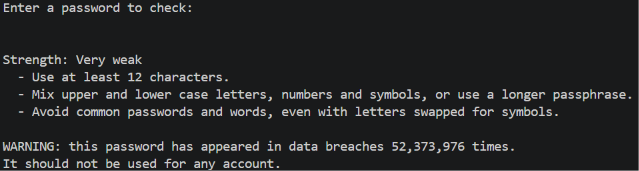
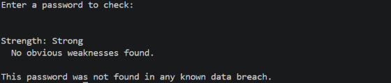
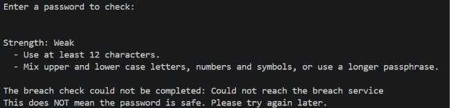
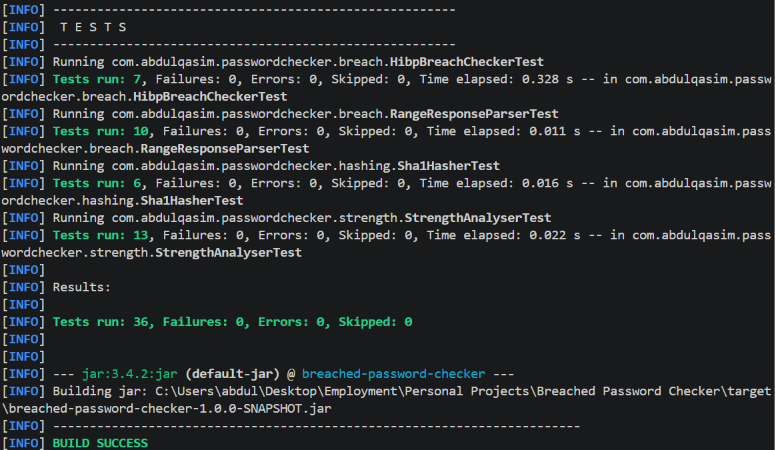

# Breached Password Checker

A command-line tool that rates a password's strength and checks whether it has appeared in known data breaches, built with **Java 21, Maven and JUnit**.

The password never leaves your computer, and neither does its full hash. Only the first 5 characters of the hash are sent to the [Have I Been Pwned](https://haveibeenpwned.com/Passwords) breach database, using a privacy technique called k-anonymity.

## Features

**Breach checking**
- Checks passwords against the Have I Been Pwned Pwned Passwords database
- k-anonymity: only a 5-character SHA-1 prefix is sent, and the comparison is done locally
- Requests padded responses, so the size of the reply reveals nothing to anyone watching the network
- Fails closed: if the check can't be completed (no internet, a server error or an unexpected reply), it reports an error and never a false "safe" result
- Strict validation of every line in the API reply, so a corrupted reply or a Wi-Fi login page is rejected rather than misread

**Strength analysis**
- Rates passwords from Very weak to Strong, entirely offline
- Rewards length and a mix of upper case, lower case, numbers and symbols
- Detects common passwords, including look-alike swaps such as `p@ssw0rd`
- Detects sequences such as `1234` or `abcd` and repeated characters such as `aaa`
- Gives suggestions for improving the password, without ever repeating part of it back on screen

**Privacy and security**
- Hidden password input with `Console.readPassword()`
- Passwords are handled as `char[]` rather than `String`, and every copy is wiped from memory after use
- Network timeouts, so a slow connection can't hang the program
- No third-party libraries at runtime; only Java's standard library

## Screenshots



| Not found in any breach | No internet connection |
|---|---|
|  |  |

## How it works

1. The password is hashed with SHA-1 on your computer, for example `password` → `5BAA61E4C9B93F3F0682250B6CF8331B7EE68FD8`.
2. Only the first 5 characters (`5BAA6`) are sent to the API.
3. The API replies with every breached hash starting with those 5 characters, which is usually around 1,000 of them.
4. The program searches that list locally for the remaining 35 characters.

The service never learns which password was checked, or even whether it was found.

## Tech stack

| Area | Technology |
|---|---|
| Language | Java 21 |
| Build | Maven |
| Testing | JUnit 6, with Java's built-in `HttpServer` as a local stand-in for the API |
| HTTP | `java.net.http.HttpClient` |
| Hashing | `java.security.MessageDigest` (SHA-1) |
| API | Have I Been Pwned Pwned Passwords range API |

## Project structure

```
src/main/java/com/abdulqasim/passwordchecker/
├── Main.java                         # Command-line entry point
├── hashing/
│   └── Sha1Hasher.java               # Password → SHA-1 hash
├── breach/
│   ├── BreachChecker.java            # Interface for any breach checker
│   ├── HibpBreachChecker.java        # Have I Been Pwned implementation
│   ├── RangeResponseParser.java      # Reads and validates the API reply
│   └── BreachCheckException.java     # Error for a check that couldn't be completed
└── strength/
    ├── StrengthAnalyser.java         # Offline strength rating and suggestions
    ├── StrengthResult.java           # Rating plus suggestions
    └── Strength.java                 # Very weak, Weak, Fair, Strong
src/test/java/...                     # Unit tests, mirroring the structure above
docs/                                 # Screenshots
```

## Testing

There are 36 unit tests, and none of them need an internet connection.

| Test class | Tests | What it covers |
|---|---|---|
| `Sha1HasherTest` | 6 | Hashes against the official SHA-1 example from the NIST standard, UTF-8 handling and empty input |
| `RangeResponseParserTest` | 10 | Finding breach counts, padding entries, Windows line endings and rejecting malformed or unexpected replies |
| `HibpBreachCheckerTest` | 7 | Uses a stand-in server on the same machine to verify that **only the 5-character prefix is ever sent** and that padding is requested, plus error statuses and an unreachable service |
| `StrengthAnalyserTest` | 13 | One test per strength rule, plus a check that the caller's password is never modified |



Run them with:

```bash
mvn test
```

## Getting started

### Prerequisites
- Java 21 or later
- Maven 3.9 or later

### Installation

```bash
git clone https://github.com/Wasaey-Q/breached-password-checker.git
cd breached-password-checker
mvn package
```

`mvn package` runs the full test suite first, and only builds the program if every test passes.

### Run

```bash
java -jar target/breached-password-checker-1.0.0-SNAPSHOT.jar
```

Type a password when prompted. Nothing appears on screen as you type, which is intended.

## Limitations
- The strength rules are deliberately simple and can't recognise names or dates, so something like `MyDogRex2019` rates as Strong. Professional tools such as [zxcvbn](https://github.com/dropbox/zxcvbn) use large word lists and statistical models.
- Wiping memory is best-effort: the Java runtime can make internal copies the program can't reach, and the full hash is briefly held in a `String`.
- SHA-1 is used only because the API requires it. It isn't suitable for storing passwords; that needs a slow, salted algorithm such as bcrypt or Argon2.
- A "not found" result only means the password isn't in the breaches Have I Been Pwned knows about.

## Possible improvements
- Recognise names, dates and keyboard patterns in the strength check
- Expand the common-password list using a published list of the most-used passwords
- Keep the full hash out of `String`s so it can be wiped as well
- Run the tests automatically on every push with GitHub Actions
